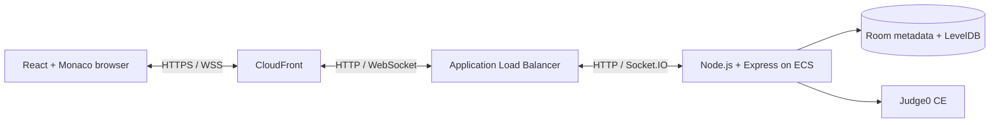

# Pairspace

**Write code together, at the same time.**

Pairspace is a real-time collaborative code editor for pairing, interviews,
teaching, and building together. Create a room, invite someone with a link, and
work in the same editor without installing anything.

[Open the live demo](https://d1xfu5caxjah7u.cloudfront.net/) ·
[View the source](https://github.com/FasihaKhanamDalazak/collab-code-editor)

> **Demo security note:** The browser-to-CloudFront connection uses HTTPS, but
> the current CloudFront-to-Application-Load-Balancer origin connection uses
> HTTP. Use demo data only; do not enter sensitive code or passwords.

## What you can do

- **Edit together live** in a shared Monaco editor, synchronized with Yjs.
- **See who's in the room** with live presence and optional collaborator
  cursors.
- **Run code together** in JavaScript, TypeScript, Python, C++, Java, or Go;
  room members see the shared result.
- **Create private rooms** with optional passwords, short room codes, and
  shareable invite links.
- **Keep working across visits** with server-side Yjs document persistence.
- **Use it on any screen** with a responsive landing page, room flow, and
  editor.

## Built with

| Frontend | Real-time collaboration | Backend and deployment |
| --- | --- | --- |
| React 19, Vite, Tailwind CSS 4 | Yjs, y-monaco, y-socket.io, Socket.IO | Node.js 24, Express 5, Docker, AWS ECS, ECR, CloudFront |
| Monaco Editor, React Router | Awareness and room-scoped documents | LevelDB persistence, Judge0 CE |

## How it works



The browser creates one Yjs document per room. Shared text, language settings,
and the latest execution result travel through a room-specific Socket.IO
namespace. The server persists Yjs updates and room metadata. Room passwords
are bcrypt hashes; joining a room issues a short-lived JWT, which is checked by
the API and bound to the matching websocket room.

## Try the live demo

Open the [Pairspace demo](https://d1xfu5caxjah7u.cloudfront.net/), then:

1. Choose **Create a room** and enter a display name.
2. Open the room and check that its connection status says **Connected**.
3. Share the invite link with another browser to try simultaneous editing.
4. Choose a language and run a small example to see shared output.

CloudFront's default domain provides HTTPS to the browser. The origin hop to
the load balancer is currently HTTP, so this demo is for portfolio evaluation
with non-sensitive data.

## Run locally

### Requirements

- Node.js 22.12 or newer (Node.js 24 LTS recommended)
- npm
- Docker Desktop or another Docker Engine (optional, for the container workflow)

### Start the backend

From the repository root, copy the example configuration:

```powershell
Copy-Item .env.example Backend/.env
```

Set a long, unique `JWT_SECRET` in `Backend/.env`. Generate one locally with:

```powershell
node -e "console.log(require('crypto').randomBytes(32).toString('hex'))"
```

Then start the API and Socket.IO server:

```powershell
cd Backend
npm install
npm start
```

### Start the frontend

In a second terminal:

```powershell
cd Frontend
npm install
npm run dev
```

Open <http://localhost:5173>. Vite proxies `/api` and `/socket.io` to
<http://localhost:3000>. If the backend uses another address, set
`VITE_API_PROXY_TARGET` in `Frontend/.env.local`.

## Configuration

The backend loads `Backend/.env`. Never commit `.env` files or share secrets.

| Variable | Default | Purpose |
| --- | --- | --- |
| `PORT` | `3000` | HTTP and Socket.IO port |
| `JWT_SECRET` | Temporary random secret in development; required in production | Signs room tokens; use one stable, high-entropy value across restarts. |
| `DATA_DIR` | `Backend/data` locally; `/app/data` in the container | Room metadata and Yjs LevelDB persistence directory |
| `JUDGE0_URL` | `https://ce.judge0.com` | Judge0 CE endpoint used to execute submitted programs |
| `FRONTEND_ORIGIN` | `http://localhost:5173` | Allowed Socket.IO browser origin |
| `VITE_API_PROXY_TARGET` | `http://localhost:3000` | Vite development proxy destination |

## Docker

Build and run the production image from the repository root:

```powershell
docker build -t pairspace .
docker volume create pairspace-data
docker run --rm -p 3000:3000 `
  -e JWT_SECRET="replace-with-a-long-random-secret" `
  -v pairspace-data:/app/data `
  pairspace
```

Open <http://localhost:3000>. The image uses Node.js 24, runs as the non-root
`node` user, includes a `/health` container health check, and serves the built
frontend, API, and Socket.IO from one port. The named volume preserves room
data when the container is replaced.

## AWS deployment

The portfolio deployment uses **Amazon ECR** for the image, **ECS Fargate** to
run the container, an **Application Load Balancer** for ingress, and
**CloudFront** for the public HTTPS endpoint. Image publishing and ECS
deployment are currently manual; pushing a commit to GitHub does not
automatically deploy it.

For each application release:

1. Build the image for the target runtime architecture.
2. Tag it with a unique version and push it to ECR.
3. Update the ECS task definition to that image tag and deploy the revision.

Example (set your account ID and use your ECR region/repository):

```bash
ACCOUNT_ID=YOUR_AWS_ACCOUNT_ID
docker buildx build --platform linux/amd64 \
  -t "$ACCOUNT_ID.dkr.ecr.eu-north-1.amazonaws.com/pairspace/server:v1" \
  --push .
```

For ECS configuration:

- Set the container port and health check to `3000` and `/health`.
- Provide `JWT_SECRET` securely at runtime, not in the image.
- Mount persistent storage at `/app/data` if room data must survive task
  replacement.
- Keep the service at **one task**. Room metadata is held in process memory
  and the LevelDB store is intended for a single writer; horizontal scaling
  needs shared state and coordination.
- Configure CloudFront behaviors for `/api/*` and `/socket.io/*` to disable
  caching and forward the required query strings and websocket handshake
  headers (for example, with the `AllViewerExceptHostHeader` origin request
  policy).
- Allow outbound HTTPS from the task to the configured Judge0 endpoint.

CloudFront HTTPS protects the viewer-to-CloudFront connection. For full
transport encryption, also configure HTTPS between CloudFront and the origin.
AWS resource availability and charges depend on the account plan, region, and
usage; verify current pricing before changing infrastructure.

## Validation

```powershell
cd Frontend
npm run lint
npm run build
```

Check the backend syntax from the repository root with:

```powershell
node --check Backend/server.js
```
